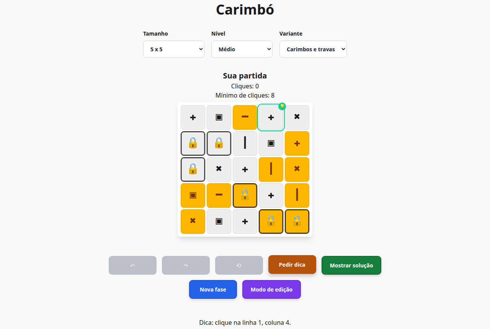

# Carimbó

## 1. Identificação

| Nome completo | Matrícula | Turma (14h/16h) | Usuário GitHub |
|---------------|-----------|-----------------|----------------|
| Arthur Alves Melo | 222037657 | 16h | @arthrok |
| Bruna de Lima Santos | 211041105 | 16h | @libruna |
| Caio Lucas Lelis Borges | 211062900 | 16h | @caio-lelis |
| Isaque Santos | 211061903 | 16h | @IsaqueSH |
| João Pedro da Silva Rodrigues | 211031074 | 16h | @joaopedrodasilvarodrigues |
| Maria Eduarda dos Santos Marques | 200023985 | 16h | @EduardaSMarques |

- **Nome do projeto:** Carimbó
- **Nome do grupo:** Apagão
- **Repositório:** https://github.com/Arthrok/paradigmas-t1
- **Commit ou tag entregue:** `v1.1`
- **Ponto de partida:** remix original
- **Slides da apresentação oral:** [`docs/apresentacao.pdf`](docs/apresentacao.pdf)

## 2. Resumo

Carimbó é um quebra-cabeça de luzes inspirado no Lights Out. Clicar numa
célula inverte as luzes no desenho do seu carimbo (cruz, xis, linha, coluna
ou bloco). Células travadas não podem ser clicadas, mas mudam com os cliques
das vizinhas. O objetivo é apagar todas as luzes. O Prolog trata cada fase
como um sistema de equações booleanas. Assim, ele diz quantas soluções a fase
tem, encontra a menor, dá dicas e gera fases novas com o número exato de
cliques pedido. O Elm cuida da interface: aplica o clique na hora, guarda o
histórico para desfazer e refazer e tem um editor de fases.



*Uma fase 5x5 da variante "Carimbos e travas". A dica do Prolog aparece
destacada na célula com a lâmpada.*

## 3. Como executar

**Requisitos**:

- Linux (Ubuntu/Debian)
- SWI-Prolog ≥ 9.2 (testado: 10.0.2)
- Node.js ≥ 20
- Python 3.13 gerenciado pelo `uv`
- `uv`
- `make`

**Instalação e execução:**

```sh
git clone https://github.com/Arthrok/paradigmas-t1.git
cd paradigmas-t1
sudo add-apt-repository ppa:swi-prolog/stable
sudo apt install swi-prolog make
curl -LsSf https://astral.sh/uv/install.sh | sh
make install
make dev
```

Abra o frontend em `http://localhost:5173` e a documentação da API em
`http://localhost:8000/docs`. Para interromper os dois servidores, use
`Ctrl+C` no terminal.

**Testes:**

```sh
make test
make lint
make build
```

**Testado em:** Linux, com Chromium. O ambiente usa SWI-Prolog ≥ 9.2,
Node.js ≥ 20, Python 3.13 e `uv`.

## 4. Arquitetura

```
 navegador                         backend
┌──────────────┐  HTTP/JSON   ┌──────────────┐   janus   ┌───────────────────────┐
│ Elm          │ ───────────► │ Python       │ ────────► │ Prolog                │
│ interface e  │ ◄─────────── │ FastAPI      │ ◄──────── │ fronteira.pl          │
│ clique local │              │ (só repassa) │           │  ├─ solver.pl  (clpb) │
└──────────────┘              └──────────────┘           │  ├─ gerador.pl        │
                                                         │  └─ regras.pl         │
                                                         └───────────────────────┘
```

O clique no tabuleiro não passa pelo backend. O Elm aplica a mesma regra do
`regras.pl` direto no navegador, para a resposta ser instantânea. O Elm só
chama o backend para gerar uma fase, verificar, pedir uma dica ou ver a
solução. Toda a lógica que exige raciocínio fica no Prolog.

| Parte  | Responsabilidade | Arquivos principais |
|--------|------------------|---------------------|
| Prolog | Regras do jogo, resolução da fase por restrições booleanas (número de soluções, solução mínima, dica) e gerador de fases | `backend/prolog/regras.pl`, `solver.pl`, `gerador.pl`, `fronteira.pl` |
| Elm    | Interface, clique local, desfazer e refazer, editor de fases e chamadas à API | `frontend/src/Main.elm`, `Fase.elm`, `Historico.elm`, `Api.elm`, `Editor.elm`, `View/Tabuleiro.elm` |
| Python | Só integração: valida o formato do JSON e repassa cada pedido a um predicado de `fronteira.pl` | `backend/app/main.py`, `backend/app/prolog.py` |

## 5. Parte em Prolog

### 5.1 Predicados principais

| Predicado | Local | O que faz |
|-----------|-------|-----------|
| `afeta(+Carimbos, ?Clicada, ?Afetada)` | `regras.pl:88` | Relaciona uma célula clicada às luzes afetadas pelo seu carimbo, também permitindo consultar quais cliques podem afetar uma luz |
| `apertar(+Posicao, +Fase, -NovaFase)` | `regras.pl:113` | Aplica um clique e produz a nova fase, invertendo as luzes afetadas; falha em uma trava |
| `modelo(+Fase, -Apertos)` | `solver.pl:55` | Declara as variáveis booleanas dos cliques e as restrições XOR de todas as luzes |
| `num_solucoes(+Fase, -Quantidade)` | `solver.pl:95` | Conta quantas soluções existem sem enumerar matrizes de apertos |
| `solucao(+Fase, -Cliques, -Total)` | `solver.pl:112` | Enumera soluções válidas por `labeling/1` e devolve os cliques e o total |
| `solucao_minima(+Fase, -Cliques, -Total)` | `solver.pl:125` | Obtém a solução com menor número de cliques usando `aggregate_all/3` |
| `dica(+Fase, -Resultado)` | `solver.pl:143` | Devolve uma posição da solução mínima, `resolvida` ou `sem_solucao` |
| `gerar(+Variante, +Tamanho, +Dificuldade, -Fase)` | `gerador.pl:52` | Gera uma fase que tenha exatamente a dificuldade mínima solicitada |
| `verificar(+Luzes, +Textos, -Resultado)` | `fronteira.pl:41` | Converte uma fase do formato textual em termo Prolog e calcula solução mínima e quantidade |
| `resolver(+Luzes, +Textos, -Resultado)` | `fronteira.pl:64` | Devolve à API a solução mínima no formato JSON esperado pelo Elm |

### 5.2 Conceitos do paradigma lógico utilizados

- [x] Fatos e regras como base de conhecimento: os tipos de carimbo e deslocamentos ficam em `deslocamentos/2`, em `regras.pl:52-59`
- [x] Unificação e casamento de padrões: `apertar/3` destrói ou preserva o termo `fase(Luzes, Carimbos)` em `regras.pl:113-126`
- [x] Recursão (inclusive sobre listas): as linhas e colunas das matrizes são percorridas por `nth0/3`, `maplist/2` e `findall/3`
- [x] Backtracking e múltiplas soluções: `repeat/0` testa novas fases no gerador em `gerador.pl:65-78`; `solucao/3` enumera soluções por backtracking em `solver.pl:112-122`
- [x] `findall/3`, `bagof/3`, `setof/3` ou similares: `findall/3` coleta as células afetadas em `regras.pl:116` e as posições booleanas em `solver.pl:57-74`
- [x] Corte (`!`) ou negação (`\+`), e por que foram necessários: o corte em `gerador.pl:62-68` encerra o laço na primeira fase válida; `\+` não é usado neste módulo
- [x] Programação por restrições (CLP(Boolean)): a library `clpb` declara XOR e testa consistência em `solver.pl:55-81`
- [x] Predicados de ordem superior (`maplist`, `foldl`, `include`...): `maplist/2` constrói apertos e restrições; `foldl/4` calcula o XOR; `aggregate_all/3` encontra o mínimo
- [x] Relação nos dois sentidos: `afeta/3` em `regras.pl:88-94` recebe a posição clicada ou a posição afetada, dependendo do argumento que está instanciado
- [x] `aggregate_all/3`: em `solucao_minima/3`, `solver.pl:125-132`, mantém o par com menor `T` entre todas as soluções encontradas

### 5.3 Trecho em destaque

```prolog
modelo(fase(Luzes, Carimbos), Apertos) :-
    maplist(maplist(aperto_permitido), Carimbos, Apertos),
    findall(Posicao, celula(Luzes, Posicao, _), Posicoes),
    maplist(restricao_da_luz(Luzes, Carimbos, Apertos), Posicoes).

restricao_da_luz(Luzes, Carimbos, Apertos, Posicao) :-
    celula(Luzes, Posicao, Luz),
    findall(Quem, afeta(Carimbos, Quem, Posicao), Quems),
    maplist(celula(Apertos), Quems, ApertosQueAfetam),
    foldl(xor, ApertosQueAfetam, 0, Paridade),
    sat(Paridade =:= Luz).

xor(Aperto, Acumulado, Acumulado # Aperto).
```

O trecho está em `solver.pl:55-81`. `modelo/2`
não recebe uma sequência pronta nem implementa a execução dos cliques:
ele declara o que significa uma solução. Cada posição de `Apertos` é uma
variável booleana ligada à matriz de carimbos; para uma trava,
`aperto_permitido/2` fixa seu valor em `0`.

Para cada posição do tabuleiro, `restricao_da_luz/4` usa `afeta/3` no sentido
de "quem precisa ser clicado para afetar esta luz". `afeta/3` é uma relação
nos dois sentidos: no gerador e no clique ela pode partir da posição clicada,
enquanto o solver parte da posição afetada. `findall/3` reúne essas posições
clicadas e `foldl/4` monta o XOR de seus apertos. A restrição
`sat(Paridade =:= Luz)` exige paridade ímpar quando a luz inicial está acesa
e paridade par quando está apagada.

É uma solução lógica porque o programa declara as equações booleanas e o
resolvedor `clpb` procura valores consistentes. Não há um algoritmo externo
que simule cada combinação: `solucao/3` pede o `labeling/1` das variáveis,
`num_solucoes/2` usa `sat_count/2` e `solucao_minima/3` usa
`aggregate_all/3` para comparar as soluções.

Esse mesmo modelo sustenta as três features: `verificar/3` conta soluções,
`dica/3` escolhe uma posição da solução mínima e `resolver/3` devolve os
cliques mínimos. A relação entre a entrada do gerador e o modelo também é
direta: em `gerador.pl:65-78`, o gerador parte do tabuleiro apagado, aplica
cliques com `foldl/4` e volta ao `modelo/2` do solver para conferir a
dificuldade mínima antes de aceitar a fase.

## 6. Parte em Elm

### 6.1 Modelo e mensagens

A implementação do frontend utiliza a arquitetura tradicional do Elm, organizada em três elementos principais: **Model**, **Update** e **View**. Essa estrutura permite separar o estado da aplicação, as operações que modificam esse estado e a interface apresentada ao usuário.

O `Model` concentra as informações necessárias para representar o estado atual do jogo, como as configurações da partida, o modo de jogo, o nível de dificuldade, a ferramenta selecionada e a posição em foco no tabuleiro.

A partida é representada por um tipo personalizado chamado `Partida`, que permite identificar diferentes situações do jogo, como a ausência de uma fase, a geração de uma nova fase, a ocorrência de erros, uma partida em andamento ou uma partida concluída.

O estado do jogo também mantém informações como o histórico de movimentos, a configuração inicial da fase, a quantidade de cliques realizados e os recursos de ajuda disponíveis. O histórico é implementado pelo módulo `Historico.elm`, que permite avançar, desfazer e refazer operações sem modificar diretamente os estados anteriores.

As mensagens (`Msg`) representam os eventos que podem ocorrer durante a execução da aplicação. Entre elas, estão ações realizadas pelo usuário, como clicar em uma posição do tabuleiro, desfazer ou refazer uma jogada, reiniciar a partida, escolher uma ferramenta e solicitar uma dica ou solução. Também existem mensagens destinadas a tratar respostas recebidas da API, como a geração de uma fase ou o retorno de uma operação de verificação.

Essa organização permite que cada evento seja tratado de maneira específica pela função `update`, responsável por receber uma mensagem e produzir o novo estado da aplicação, podendo também gerar comandos para operações assíncronas.

Os principais tipos são: 


```elm
type alias Model =
    { config : Config
    , partida : Partida
    , modo : Modo
    , nivel : Nivel
    , posicaoEmFoco : Maybe Fase.Posicao
    , ferramenta : Ferramenta
    , idDica : Int
    }

type Partida
    = SemFase
    | Gerando
    | FalhaAoGerar String
    | Jogando Jogo
    | Vencida Jogo

type alias Jogo =
    { historico : Historico.Historico Fase.Fase
    , inicial : Fase.Fase
    , cliques : Int
    , minimo : Int
    , ajuda : Ajuda
    }

type Ajuda
    = SemAjuda
    | PedindoDica
    | Dica Fase.Posicao
    | PedindoSolucao
    | Verificando
    | AnimandoSolucao (List Fase.Posicao)
    | ErroAjuda String
    | ResultadoVerificacao Int (Maybe Int)

type Msg
    = MudouConfig Config
    | MudouTamanho Int
    | MudouNivel Nivel
    | MudouVariante Api.Variante
    | NovaFase
    | FaseGerada (Result String { fase : Fase.Fase, minimo : Int })
    | Clicou Fase.Posicao
    | Desfazer
    | Refazer
    | Reiniciar
    | PedirDica
    | PedirSolucao
    | Verificar
    | AplicouFerramenta Fase.Posicao
    | MudouModo Modo
    | EscolheuFerramenta Ferramenta
    -- Demais mensagens de interação e respostas da API.
```


O tipo Partida representa os diferentes estados possíveis de uma partida. Essa escolha evita utilizar vários valores booleanos para controlar situações como geração, jogo em andamento, falha e vitória.

O tipo Ajuda organiza os estados relacionados às funcionalidades de dica, resolução e verificação. Por exemplo, PedindoDica indica uma solicitação em andamento, enquanto Dica Fase.Posicao armazena a posição retornada pela API.

Também são utilizados outros tipos personalizados:
- Modo: diferencia os modos Jogar e Editar.
- Nivel: representa as dificuldades Facil, Medio e Dificil.
- Api.Variante: representa as variantes clássica, carimbos e carimbos com travas.
- Editor.Ferramenta: representa as ferramentas de edição.
- Fase.Celula: diferencia células ativas e travadas, armazenando suas respectivas luzes.


A utilização desses tipos permite representar explicitamente os estados válidos do sistema e utilizar o casamento de padrões (case) para tratar cada possibilidade.

O tipo Maybe é utilizado quando uma informação pode não existir, como na posição em foco e no número mínimo de cliques de uma fase ainda não verificada. Já o tipo Result representa operações que podem produzir um valor ou uma mensagem de erro, como a criação de fases e as respostas da API.


### 6.2 Conceitos do paradigma funcional utilizados

Durante o desenvolvimento do frontend, foram utilizados diversos conceitos fundamentais da programação funcional.

- **Tipos personalizados (Custom Types):** utilizados para representar os estados e elementos do jogo. Exemplos são `Luz`, `Forma`, `Celula`, `Ferramenta` e `Partida`. Esses tipos tornam o código mais expressivo e permitem representar explicitamente as possibilidades de cada elemento.

- **Correspondência de padrões (Pattern Matching):** utilizada por meio de expressões `case` para tratar diferentes valores de tipos personalizados. Isso permite implementar comportamentos específicos para cada situação, além de facilitar a identificação de casos que precisam ser tratados.

- **Imutabilidade:** os dados não são modificados diretamente. Quando ocorre uma alteração no tabuleiro ou no estado da aplicação, uma nova estrutura é produzida a partir da anterior. Em registros, essa atualização pode ser realizada por meio da sintaxe `{ model | campo = novoValor }`.

- **Tipos `Maybe` e `Result`:** utilizados para representar situações em que um valor pode estar ausente ou uma operação pode falhar. O tipo `Maybe` permite representar a ausência de informações, enquanto `Result` possibilita retornar um resultado de sucesso ou uma mensagem de erro, evitando o uso de exceções.

- **Funções de ordem superior:** funções como `List.map`, `List.indexedMap`, `List.filter` e `List.all` são utilizadas para percorrer, transformar e verificar elementos de listas. Essas operações permitem manipular o tabuleiro de maneira declarativa, sem a necessidade de estruturas tradicionais de repetição.

- **Composição de funções:** o operador `|>` é utilizado para encadear operações, tornando o fluxo de transformação dos dados mais legível. Também são utilizadas funções como `Result.andThen` para encadear operações que podem produzir erros.

- **Manipulação de JSON:** o módulo `Api.elm` utiliza codificadores e decodificadores para converter os dados entre as estruturas do Elm e o formato JSON utilizado na comunicação com o backend.

- **Comunicação assíncrona:** as requisições HTTP são realizadas por meio do módulo `Http` e dos comandos `Cmd`, permitindo que o frontend se comunique com o backend sem bloquear a execução da interface.

- **Separação de responsabilidades:** o código foi dividido em módulos que concentram responsabilidades específicas. O módulo `Fase.elm` contém as regras relacionadas ao domínio do jogo; `Editor.elm` implementa operações de edição do tabuleiro; `Historico.elm` gerencia o histórico de movimentos; `Api.elm` concentra a comunicação com o backend; e `Main.elm` organiza o estado geral, o tratamento de eventos e a interface.

Essa divisão facilita a manutenção do projeto, pois cada módulo possui uma responsabilidade bem definida, reduzindo o acoplamento entre as diferentes partes da aplicação.


### 6.3 Trecho em destaque


Um exemplo da aplicação dos conceitos funcionais pode ser observado na função `apertar`, presente no módulo `Fase.elm`. Essa função recebe uma posição do tabuleiro e uma fase, identifica as células afetadas pela jogada e retorna uma nova fase com os estados dessas células invertidos.


```elm
apertar : Posicao -> Fase -> Fase
apertar posicao fase =
    let
        alvos =
            afetadas posicao fase

        inverterSeAfetada l c cel =
            if List.member { linha = l, coluna = c } alvos then
                inverter cel
            else
                cel
    in
    Fase
        (List.indexedMap
            (\l fileira ->
                List.indexedMap (inverterSeAfetada l) fileira
            )
            (linhas fase)
        )

```


Inicialmente, a função utiliza afetadas para determinar quais posições do tabuleiro devem sofrer alterações a partir da posição selecionada. Em seguida, define a função auxiliar inverterSeAfetada, que verifica se cada célula pertence à lista de posições afetadas. Caso pertença, seu estado é invertido por meio da função inverter; caso contrário, a célula permanece inalterada.

A transformação do tabuleiro é realizada utilizando List.indexedMap, que percorre as linhas e colunas preservando seus respectivos índices. Dessa forma, é possível identificar a posição de cada célula e aplicar a alteração somente nos elementos correspondentes.

Esse trecho demonstra características importantes da programação funcional, como a utilização de funções de ordem superior, a composição de operações e a imutabilidade dos dados. Em vez de modificar diretamente o tabuleiro original, a função constrói e retorna uma nova estrutura com o resultado da jogada.

Assim, a lógica de atualização do tabuleiro permanece isolada e previsível, facilitando os testes e a manutenção do código.


## 7. Integração

O Elm conversa com o backend por quatro rotas HTTP. Todas recebem e devolvem
JSON. O Python valida o formato com Pydantic e chama um predicado de
`fronteira.pl` pela biblioteca janus. O contrato completo, com exemplos,
está em [`docs/api.md`](docs/api.md).

Uma fase trafega como duas matrizes NxN, com N de 4 a 6:

```json
{ "luzes": [[1, 0, ...], ...], "carimbos": [["cruz", "trava", ...], ...] }
```

Em `luzes`, 1 significa acesa. Em `carimbos`, os valores possíveis são
`cruz`, `xis`, `linha`, `coluna`, `bloco` ou `trava`.

| Rota / chamada | Entrada | Saída | Predicado Prolog |
|----------------|---------|-------|------------------|
| `POST /api/gerar` | `{tamanho, dificuldade, variante}` | `{fase, minimo}` | `fronteira:gerar/5` |
| `POST /api/verificar` | `{fase}` | `{solucoes, minimo}` (`minimo` é `null` se não há solução) | `fronteira:verificar/3` |
| `POST /api/dica` | `{fase}` | `{linha, coluna}` | `fronteira:dica/3` |
| `POST /api/resolver` | `{fase}` | `{cliques: [[l, c], ...], minimo}` | `fronteira:resolver/3` |

Quando um pedido viola uma regra do jogo, a resposta é **422** com
`{"detail": "<mensagem>"}`. Isso acontece quando a dificuldade é impossível,
quando a fase não tem solução ou quando ela já está resolvida. O Elm mostra
essa mensagem ao jogador.

## 8. Testes e validação

O projeto usa três níveis de testes automáticos:

- **PLUnit** em `backend/prolog/test_*.pl`: regras dos carimbos, bordas,
  resoluções, geração e fronteira com o Python.
- **pytest** em `backend/tests/test_api.py`: contrato HTTP, formatos JSON,
  códigos de status e mensagens de regra de negócio.
- **elm-test** em `frontend/tests/*.elm`: domínio Elm, decoders/encoders,
  estados da interface e casos de resposta da API.

Executar todos os testes e verificações locais:

```sh
make test
make lint
make build
```

### Casos de borda

| Caso de borda | Comportamento esperado | Evidência automática |
|---|---|---|
| Dica em fase resolvida | 422 com `"A fase já está resolvida."` | pytest `test_dica_em_fase_resolvida`; elm-test em `ApiTest` e `MainTest` |
| Fase sem solução | 200 com `solucoes: 0` ao verificar; dica e resolução retornam 422 com `"Esta fase não tem solução."` | pytest `test_verificar_sem_solucao_nao_e_erro`, `test_dica_sem_solucao` e `test_resolver_sem_solucao`; elm-test em `MainTest` |
| Dificuldade impossível | 422 com `"Não foi possível gerar uma fase com essa dificuldade."` | pytest `test_gerar_dificuldade_impossivel`; PLUnit em `test_gerador.pl` |
| Tamanho inválido | rejeita tamanhos fora de 4–6 e matrizes não NxN | pytest `test_gerar_rejeita_tamanho_fora_da_faixa` e `test_verificar_rejeita_matriz_nao_quadrada`; elm-test em `FaseTest` e `EditorTest` |
| Carimbo inválido | rejeita nome fora das formas conhecidas | pytest `test_verificar_rejeita_carimbo_desconhecido`; elm-test em `ApiTest` |
| Backend fora do ar ou inacessível | Elm transforma falha de rede/timeout em uma mensagem de erro, sem considerar resposta como sucesso | elm-test em `ApiTest` (`backend fora do ar` e `timeout`) |

No Linux, o roteiro manual ponta a ponta consiste em iniciar `make dev`,
gerar uma fase em cada variante, pedir uma dica, verificar que a dica deixa o
tabuleiro válido, seguir a solução até a vitória e repetir o fluxo no editor.
O resultado deve coincidir com as rotas documentadas em `docs/api.md`.

## 9. Limitações e problemas conhecidos

- **Tabuleiro de no máximo 6x6.** No modo clássico (só cruz), o gerador não
  conseguiu montar fases 7x7 dentro do limite de tempo. Por isso o tamanho
  ficou entre 4 e 6.
- **O gerador tem limite de 5 segundos.** Ele tenta sorteios até achar uma
  fase cuja solução mínima tenha exatamente o número de cliques pedido. Para
  dificuldades altas demais, ele desiste depois de 5 s e o jogo mostra
  "Não foi possível gerar uma fase com essa dificuldade". Os níveis Fácil,
  Médio e Difícil foram calibrados para gerar rápido em todas as variantes.
- **A solução mínima é encontrada por enumeração.** O solver lista todas as
  soluções e escolhe a menor. Isso funciona porque, nas fases que testamos
  nos tamanhos permitidos, nenhuma passou de 4 soluções. Em tabuleiros
  maiores, com mais soluções, essa estratégia ficaria lenta.
- **A regra do clique existe em dois lugares.** A tabela de deslocamentos
  dos carimbos está em `regras.pl` e também em `Fase.elm`, para o clique ser
  instantâneo. Se uma mudar sem a outra, o tabuleiro e o solver passam a
  discordar. Os testes dos dois lados conferem a mesma tabela, mas nada
  impede essa divergência automaticamente.
- **O frontend depende do backend para as features de raciocínio.** Sem o
  backend, ainda dá para clicar numa fase já carregada. Gerar, verificar,
  pedir dica e ver a solução mostram uma mensagem de erro.
- **Atraso na entrega.** A interface só ficou completa em 22/11, depois do
  primeiro prazo (18/11).

## 10. Contribuição de cada integrante

| Integrante | Principais contribuições |
|------------|--------------------------|
| Arthur Alves Melo | Documentação de projeto (arquitetura, ADRs, contrato da API, plano de issues); base do projeto e CI (#1, #3); todo o Prolog: `regras.pl`, `solver.pl`, `gerador.pl` e `fronteira.pl` (#4–#8); rotas FastAPI e testes pytest (#9); `Fase.elm` e testes fuzz (#10, #12); seções 1, 2, 4 e 7 do relatório (#22) |
| Bruna de Lima Santos | `View/Tabuleiro.elm`: grid, ícones dos carimbos, pré-visualização do clique, acessibilidade e visual responsivo (#14); dica na interface, com destaque da célula, bloqueio de pedidos duplicados e mensagens de erro (#17) |
| Caio Lucas Lelis Borges | Solução mínima na interface: animação da solução e tela de vitória (#18); `Editor.elm`: editor de fases com verificação de solução (#20) |
| Isaque Santos | `Api.elm`: requisições, encoders e decoders (#13); integração ponta a ponta, casos de borda e teste de backend fora do ar (#21); seções 3 e 8 do relatório |
| João Pedro da Silva Rodrigues | `Main.elm`: Model, Msg, máquina de estados e clique local (#15); tela de nova fase com tamanho, nível e variante (#16); seções 6, 9 e 10 do relatório (#24, #25) |
| Maria Eduarda dos Santos Marques | `Historico.elm` e testes (#11); desfazer, refazer e reiniciar na interface (#19); seção 5 do relatório (#23); revisão e merge dos PRs |

## 11. Fontes, código de terceiros e uso de IA

**Código reaproveitado.** Partimos do template do professor
([fabiommendes/paradigmas-trabalho-final](https://github.com/fabiommendes/paradigmas-trabalho-final)).
Dele mantivemos:
- a configuração do backend (`pyproject.toml`, FastAPI e janus);
- a estrutura do frontend (Vite, Tailwind/daisyUI, `index.html`,
  `main.js`, `elm.json`);
- o modelo deste relatório, o da avaliação 360 e o script
  `scripts/validar_entrega.py`.

Nada do código do Sudoku foi aproveitado. Todos os arquivos `.pl`, todos os
módulos `.elm`, as rotas em `backend/app/` e os testes são deste projeto.

**Referências.**

- Documentação do SWI-Prolog, em especial `library(clpb)` (restrições
  booleanas: `sat/1`, `sat_count/2`, `labeling/1`), `library(plunit)`,
  `call_with_time_limit/2` e a interface janus com Python.
- Documentação do Elm (guia oficial e pacotes `elm/http`, `elm/json` e
  `elm-explorations/test`, incluindo os testes fuzz).
- Documentação do FastAPI e do Pydantic.
- A formulação clássica do Lights Out como um sistema linear sobre GF(2):
  cada clique é uma variável 0/1 e cada luz, uma equação XOR. Ela é a base
  do modelo do `solver.pl` ([ADR 0004](docs/adr/0004-modelo-clpb.md)).

**Uso de ferramentas de IA.**

- **Faixa de uso no código:** intensivo

A IA escreveu a maior parte do código do backend (Prolog e Python), o
domínio do jogo no Elm (`Fase.elm`) e boa parte da documentação. Para não
perder o controle do projeto, o grupo tomou estes cuidados:

1. **Arquitetura definida antes do código.** Antes de qualquer
   implementação, escrevemos e revisamos a arquitetura, o contrato da API,
   o design de cada linguagem e 8 ADRs (`docs/`). O código gerado teve que
   seguir essas decisões, e não o contrário.
2. **A regra própria foi validada antes de ser adotada.** Um protótipo
   descartável (`docs/validacao/`) conferiu que "carimbos + células
   travadas" funciona com as 5 features: todas as fases geradas tinham a
   dificuldade pedida e todas as dicas estavam corretas.
3. **Testes que conferem o resultado por um caminho independente.** São 39
   testes PLUnit, 13 pytest e 89 elm-test, todos rodando no CI a cada PR.
   Exemplos:
   - aplicar a solução encontrada pelo solver com o simulador de cliques
     precisa apagar o tabuleiro;
   - seguir a dica precisa reduzir o mínimo em 1;
   - testes fuzz conferem que clicar duas vezes desfaz o clique e que a
     ordem dos cliques não importa, que são as propriedades que justificam
     o modelo do Prolog.
4. **Limites medidos e documentados.** Os tamanhos, os níveis e o limite de
   tempo do gerador vieram de medições, e o que não funcionou (7x7, por
   exemplo) está registrado nos ADRs e na seção 9.
5. **Divisão por issues e revisão por PR.** Cada parte foi uma issue com um
   responsável. Quase todos os PRs foram mesclados por um integrante
   diferente do autor.
   Cada integrante deve saber explicar o código atribuído a ele na seção 10.

| Ferramenta | Para que foi usada | Como o grupo verificou o resultado |
|------------|--------------------|------------------------------------|
| Claude Code (modelo Claude Opus) | Documentação de projeto (arquitetura, ADRs, contrato da API, plano de issues); protótipo de validação da regra; todo o Prolog (`regras.pl`, `solver.pl`, `gerador.pl`, `fronteira.pl`); rotas FastAPI; `Fase.elm`; testes dessas partes; seções 2, 4, 7, 9, 10, 11 e 13 deste relatório; captura de tela | Revisão do código e dos PRs pelo grupo; testes automáticos no CI; conferência de casos conhecidos (clássico 5x5 com o centro aceso tem 4 soluções e mínimo 11); execução manual do jogo de ponta a ponta |

## 12. Apresentação oral

- **Slides:** [`docs/apresentacao.pdf`](docs/apresentacao.pdf)
- **Roteiro:**

| Parte | Duração | Quem apresenta |
|-------|:-------:|----------------|
| Contexto e objetivo: o Lights Out, a regra própria (carimbos e travas) e as 5 features | 2 min | Isaque Santos |
| Demonstração: gerar fase em cada variante, jogar, desfazer, pedir dica | 3 min | João Pedro da Silva Rodrigues |
| Demonstração: mostrar a solução mínima, vitória e editor de fases com verificação | 2 min | Caio Lucas Lelis Borges |
| Código Prolog: a restrição XOR em `solver.pl` e como o mesmo modelo responde F1, F2 e F3 | 3 min | Maria Eduarda dos Santos Marques |
| Código Elm: os tipos `Celula` e `Fase`, o `update` do `Main.elm` e um teste fuzz | 3 min | Bruna de Lima Santos |
| Limitações e aprendizados | 2 min | Arthur Alves Melo |

## 13. Reflexão sobre os paradigmas

O que deixou o Prolog mais simples foi descrever o problema em vez de explicar como chegar à resposta. Numa linguagem imperativa, resolver uma fase seria escrever uma busca: testar várias combinações de cliques, simular cada uma e guardar a melhor. No Prolog, só dizemos o que é uma solução: para cada luz, os cliques que a afetam precisam, em XOR, dar o valor dela. Um único modelo (modelo/2) respondeu a três perguntas diferentes: quantas soluções existem (F1), qual é a menor (F3) e qual é o próximo clique (F2). O gerador (F4) usa o mesmo solver para conferir a dificuldade. O difícil ficou no outro lado dessa abstração: entender o que o motor faz de fato. Um findall que copiava variáveis desligava as restrições sem mostrar erro, e um predicado de otimização que parecia certo na teoria demorava minutos. Nos dois casos, o código parecia certo e só os testes mostraram o erro.

No Elm, o compilador transformou várias regras do jogo em garantias. O tipo Celula = Ativa Forma Luz | Travada Luz impede que uma célula travada tenha carimbo. Como o tipo Fase é opaco, toda fase no programa é quadrada e tem tamanho válido. Cada resposta HTTP chega como Result, e o compilador obriga a tratar erros. Assim, quando o backend cai, aparece uma mensagem na tela em vez de a tela quebrar. Quando alguém adicionava uma mensagem nova, o compilador mostrava todos os case que precisavam lidar com ela.

As duas linguagens mudaram o jeito de pensar de forma parecida: nenhuma delas muda nada diretamente. No Prolog, pensamos em relações, ou seja, o que é verdade numa fase. No Elm, pensamos em como transformar: dado um estado e uma mensagem, qual será o próximo estado. As duas ideias se juntaram nos testes fuzz do Elm. As propriedades que esses testes conferem, como clicar duas vezes desfazer o clique ou a ordem não importar, são as mesmas que sustentam o modelo de restrições do Prolog.
