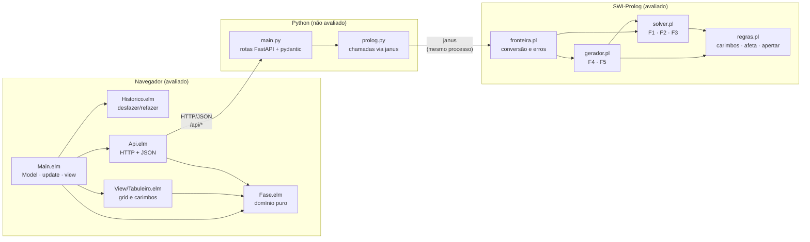
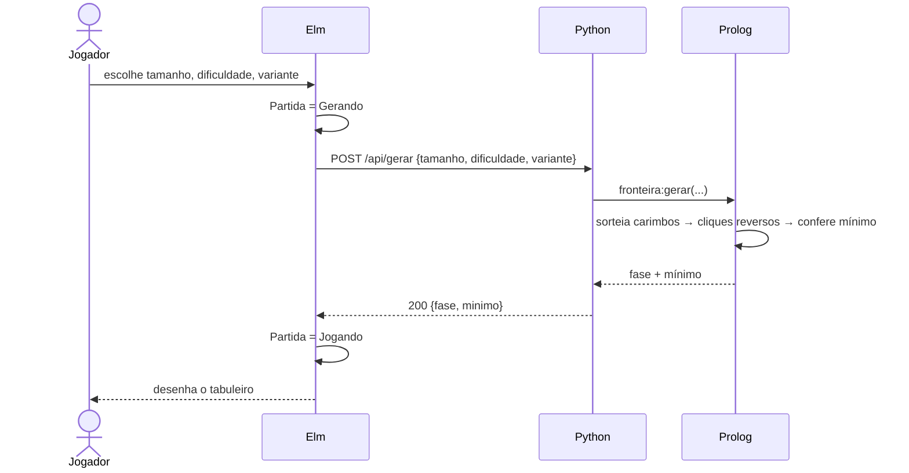
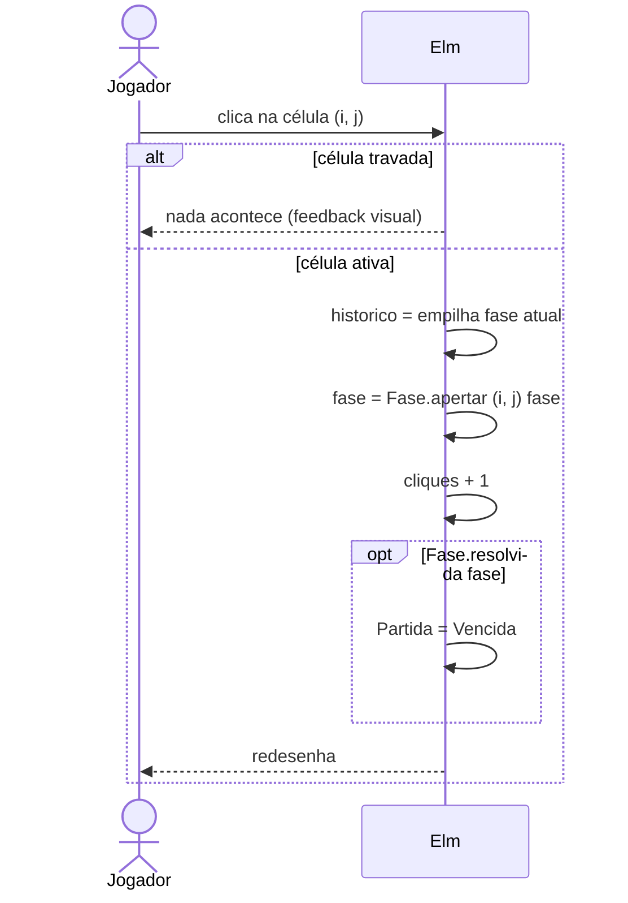
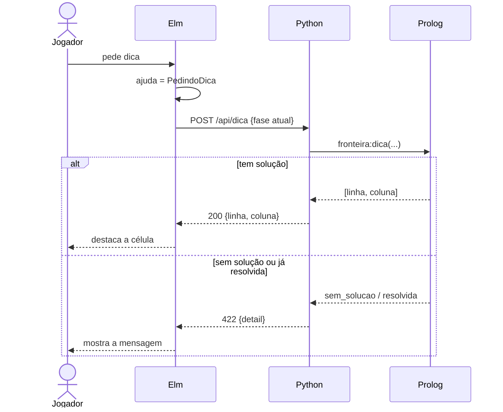

# Arquitetura

## Visão geral



| Camada | Responsabilidade | Não faz |
|---|---|---|
| **Elm** | Guardar o estado, aplicar cliques, desenhar, chamar a API | Resolver, gerar, dar dica |
| **Python** | Receber HTTP, validar a forma do JSON, chamar o predicado, traduzir erros em 422 | Nenhuma regra de jogo |
| **Prolog** | Regras, modelo de restrições, as 5 features | Guardar estado, HTTP |

## Quem faz cada feature

| Feature | Prolog | Rota | Elm |
|---|---|---|---|
| F1 Verificar solução | `solver:num_solucoes/2` | `POST /api/verificar` | Editor de fases |
| F2 Dica | `solver:dica/2` | `POST /api/dica` | Destaque na célula sugerida |
| F3 Solução mínima | `solver:solucao_minima/3` | `POST /api/resolver` | "Mínimo: K", animação da solução, tela de vitória |
| F4 Gerador | `gerador:gerar/4` | `POST /api/gerar` | Tela "nova fase" |
| F5 Variantes | `gerador:variante/3` | parâmetro `variante` de `/api/gerar` | Seletor de variante |

## Fluxos principais

### Nova fase (F4 + F5)



### Clique (local, sem servidor)



### Dica (F2)



## Decisões

Os porquês estão nos [ADRs](adr/README.md). Os mais importantes para entender
este diagrama são o [0003](adr/0003-estado-no-elm.md) (estado no Elm) e o
[0006](adr/0006-clique-aplicado-no-elm.md) (clique local).

## Estrutura de pastas (alvo)

```
backend/
  prolog/
    regras.pl            carimbos, afeta/4, apertar/3, resolvida/1
    solver.pl            modelo/3, num_solucoes/2, solucao_minima/3, dica/2
    gerador.pl           variante/3, gerar/4
    fronteira.pl         API pública para o Python: conversão string↔átomo, erros
    test_regras.pl       plunit
    test_solver.pl       plunit
    test_gerador.pl      plunit
  app/
    prolog.py            ponte janus (uma função por predicado da fronteira)
    main.py              rotas FastAPI + modelos pydantic
  tests/test_api.py      pytest
frontend/
  src/
    Fase.elm             tipos do domínio, apertar, resolvida, criar
    Historico.elm        pilha de desfazer/refazer (genérica, pura)
    Api.elm              requisições, encoders, decoders, tipo Remoto
    View/Tabuleiro.elm   view do grid e ícones dos carimbos
    Main.elm             Model, Msg, update, view, subscriptions
    main.js, style.css
  tests/
    FaseTest.elm         fuzz: apertar 2x = identidade, comutatividade...
    HistoricoTest.elm
docs/                    esta documentação
RELATORIO.md             relatório de entrega (template do professor)
Makefile                 install, dev, test, validar
```
