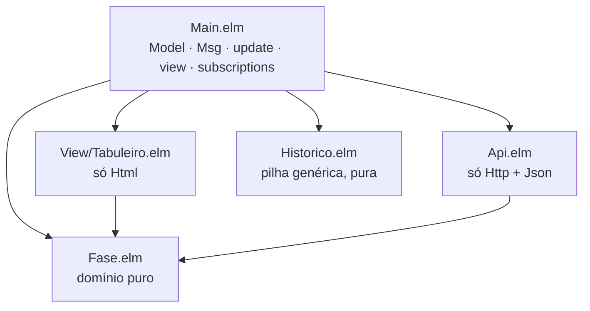
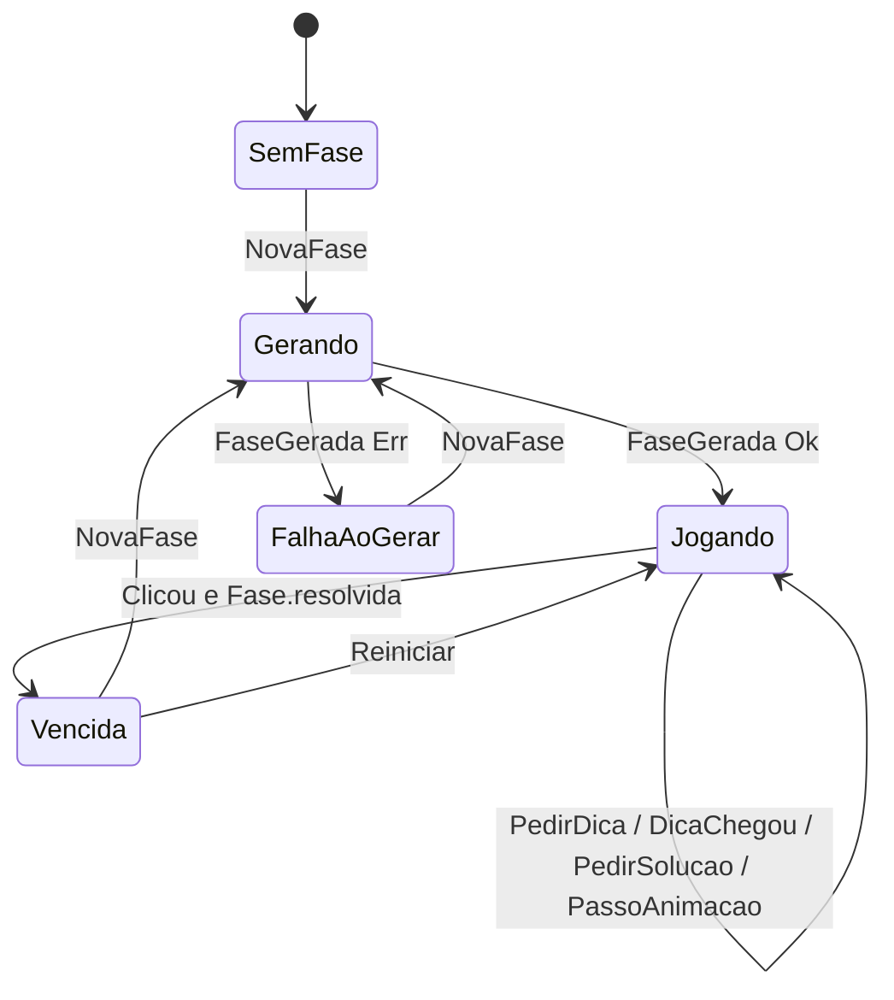

# Design do Elm

Responsáveis: Maria Eduarda (`Fase.elm`, `Historico.elm`, testes), João Pedro
(`Api.elm`, `Main.elm`), Bruna (`View/Tabuleiro.elm`, visual). Veja o
[plano de issues](plano-de-issues.md).

O critério de Elm vale **30%** da nota. O que o nível 3–4 da rubrica pede:

- custom types que tornem **estados inválidos irrepresentáveis**, e não `Bool` para tudo;
- `Maybe`/`Result` bem usados, sem `Maybe.withDefault` espalhado;
- decoders próprios;
- **módulos com fronteiras claras**: domínio puro separado de HTTP e de view.

## Módulos



`Fase.elm` e `Historico.elm` **não importam `Html` nem `Http`**. Isso torna a
fronteira verificável: é só olhar os `import`.

## `Fase.elm`: domínio

```elm
module Fase exposing
    ( Fase, Celula(..), Forma(..), Luz(..), Posicao
    , criar, tamanho, celula, linhas
    , apertar, resolvida, inverterLuz
    )

type Luz = Acesa | Apagada

type Forma = Cruz | Xis | Linha | Coluna | Bloco

-- Uma célula travada não tem forma: isso é impossível de representar.
type Celula
    = Ativa Forma Luz
    | Travada Luz

type alias Posicao = { linha : Int, coluna : Int }

-- Opaco: o construtor não é exportado. Toda Fase existente é NxN, com 4 ≤ N ≤ 7.
type Fase = Fase { n : Int, celulas : Array (Array Celula) }

criar : List (List Celula) -> Result String Fase
apertar : Posicao -> Fase -> Fase      -- célula travada ou fora do tabuleiro: devolve igual
resolvida : Fase -> Bool
```

`apertar` implementa a **mesma tabela de deslocamentos** do
[design do Prolog](design-prolog.md#regraspl-base-de-conhecimento-do-jogo).

## `Historico.elm`: desfazer e refazer

```elm
type Historico a = Historico { passado : List a, atual : a, futuro : List a }

iniciar : a -> Historico a
avancar : a -> Historico a -> Historico a   -- limpa o futuro
desfazer : Historico a -> Historico a
refazer : Historico a -> Historico a
atual : Historico a -> a
```

É genérico (`a`) e não conhece `Fase`: uma boa demonstração de tipos
paramétricos.

## `Api.elm`: HTTP e JSON

```elm
type Remoto a
    = NaoPedido
    | Carregando
    | Sucesso a
    | Falha String

type Variante = Classico | Carimbos | CarimbosTravas

gerar     : { tamanho : Int, dificuldade : Int, variante : Variante } -> (Result String { fase : Fase, minimo : Int } -> msg) -> Cmd msg
verificar : Fase -> (Result String { solucoes : Int, minimo : Maybe Int } -> msg) -> Cmd msg
dica      : Fase -> (Result String Posicao -> msg) -> Cmd msg
resolver  : Fase -> (Result String { cliques : List Posicao, minimo : Int } -> msg) -> Cmd msg

faseDecoder : Decoder Fase          -- junta "luzes" + "carimbos" e termina com Fase.criar
encodeFase : Fase -> Value
```

- O decoder de `Fase` usa `Decode.andThen` com o `Result` de `Fase.criar`, para
  que um JSON inválido vire uma falha de decodificação, e não uma fase quebrada.
- O 422 vira `Err "mensagem"` lendo o campo `detail` (como no template).

## `Main.elm`: estado e máquina de estados

```elm
type alias Model =
    { config : Config            -- tamanho, dificuldade, variante escolhidos
    , partida : Partida
    , modo : Modo
    }

type Modo = Jogar | Editar

type Partida
    = SemFase
    | Gerando
    | FalhaAoGerar String
    | Jogando Jogo
    | Vencida Jogo

type alias Jogo =
    { historico : Historico Fase
    , inicial : Fase
    , cliques : Int
    , minimo : Int
    , ajuda : Ajuda
    }

type Ajuda
    = SemAjuda
    | PedindoDica
    | Dica Posicao
    | PedindoSolucao
    | AnimandoSolucao (List Posicao)    -- consumida por Time.every
    | ErroAjuda String
```



### Mensagens

```elm
type Msg
    = MudouConfig Config
    | NovaFase
    | FaseGerada (Result String { fase : Fase, minimo : Int })
    | Clicou Posicao
    | Desfazer
    | Refazer
    | Reiniciar
    | PedirDica
    | DicaChegou (Result String Posicao)
    | PedirSolucao
    | SolucaoChegou (Result String { cliques : List Posicao, minimo : Int })
    | PassoAnimacao Time.Posix
    | MudouModo Modo
      -- editor (F1)
    | EditouCelula Posicao Celula
    | Verificar
    | VerificacaoChegou (Result String { solucoes : Int, minimo : Maybe Int })
```

## Telas

```
┌────────────────────────────────────────────┐
│  Carimbó                       [Jogar|Editar]│
├────────────────────────────────────────────┤
│  Tamanho [5▾]  Nível [Médio▾]  Variante [▾]  │
│  [ Nova fase ]                               │
│                                              │
│      ┌──┬──┬──┬──┬──┐   Cliques: 4          │
│      │✚ │✖ │🔒│━ │✚ │   Mínimo:  8          │
│      ├──┼──┼──┼──┼──┤                        │
│      │▣ │✚ │┃ │✖ │✚ │   [💡 Dica]           │
│      │  ...         │   [↶] [↷] [⟲]         │
│      └──┴──┴──┴──┴──┘   [Mostrar solução]    │
└────────────────────────────────────────────┘
```

- Acesa/apagada é a cor da célula; o carimbo é um ícone na célula; travada
  tem cadeado e cursor bloqueado.
- **Passar o mouse** sobre uma célula pré-visualiza as células que o carimbo
  dela afeta (usa `Fase` puro, sem servidor).
- Níveis pré-definidos (`Fácil`/`Médio`/`Difícil`) viram a dificuldade
  numérica pelo tamanho. No 5x5: 4, 8 e 12. Para outros tamanhos, calibrar na
  issue do gerador.

## Testes (`elm-test`)

| Teste | Tipo |
|---|---|
| `apertar p (apertar p f) == f` para todo `p`, `f` | fuzz |
| `apertar a (apertar b f) == apertar b (apertar a f)` | fuzz |
| apertar uma `Travada` não muda nada | fuzz |
| `criar` rejeita matriz não quadrada e tamanho fora de 4..7 | unitário |
| cada `Forma` afeta exatamente as células da tabela | unitário |
| `desfazer (avancar x h)` volta para `atual h` | fuzz |
| decoder de `Fase` aceita o exemplo de `docs/api.md` e rejeita carimbo inválido | unitário |

## Convenções

- `elm-format` em todo arquivo (é medido).
- Sem `Maybe.withDefault` para esconder um caso impossível. Se ele é
  impossível, o tipo deveria impedir.
- Nomes do domínio em português, iguais ao Prolog (`fase`, `carimbo`,
  `apertar`).
