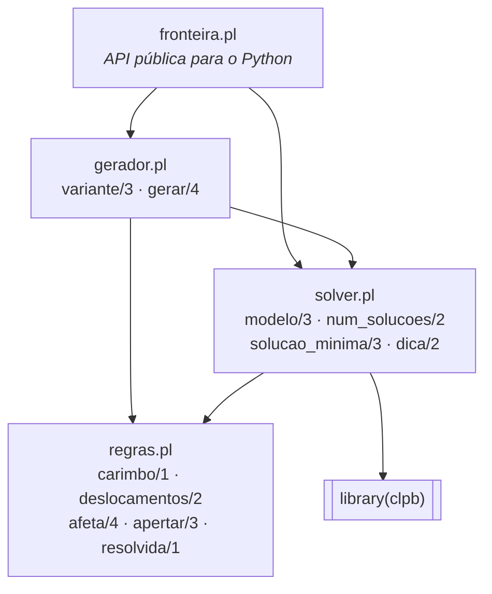

# Design do Prolog

Responsáveis: Caio (`regras.pl`, `gerador.pl`), Isaque (`solver.pl`), Arthur
(`fronteira.pl`). Veja o [plano de issues](plano-de-issues.md).

## Módulos



Regra de dependência: **só setas para baixo**. O `regras.pl` não conhece
ninguém, e só o `fronteira.pl` sabe que existe um Python do outro lado.

## Representação interna

```prolog
fase(Luzes, Carimbos)
%   Luzes:    lista de N listas de N inteiros 0/1
%   Carimbos: lista de N listas de N átomos (cruz, xis, linha, coluna, bloco, trava)
%   Posição:  Linha-Coluna  (par com -, índice a partir de 0)
```

Os strings vindos do Python viram átomos **só** em `fronteira.pl`.

## `regras.pl`: base de conhecimento do jogo

> **Fonte única dos deslocamentos.** O `Fase.elm` precisa implementar
> exatamente esta tabela (ADR 0006).

| Carimbo | Deslocamentos `DLinha-DColuna` afetados |
|---|---|
| `cruz` | `0-0, -1-0, 1-0, 0-(-1), 0-1` |
| `xis` | `0-0, -1-(-1), -1-1, 1-(-1), 1-1` |
| `linha` | `0-0, 0-(-1), 0-1, 0-(-2), 0-2` |
| `coluna` | `0-0, -1-0, 1-0, -2-0, 2-0` |
| `bloco` | os 9 de `-1..1 × -1..1` |
| `trava` | nenhum: não pode ser clicada |

Deslocamentos que caem fora do tabuleiro são ignorados (não dão a volta).

| Predicado | Modo | Descrição |
|---|---|---|
| `carimbo(?Nome)` | nondet | fatos: os 6 tipos de célula |
| `deslocamentos(+Nome, -Lista)` | det | fatos: a tabela acima |
| `afeta(+N, +Carimbos, ?Clicada, ?Afetada)` | nondet | clicar `Clicada` inverte `Afetada`. É uma **relação**: serve nos dois sentidos ("quem eu afeto?" e "quem me afeta?") |
| `apertar(+Fase, +Pos, -Fase2)` | semidet | aplica um clique; falha se `Pos` for `trava`. É o simulador usado nos testes e no gerador |
| `resolvida(+Fase)` | semidet | todas as luzes apagadas |

## `solver.pl`: F1, F2, F3

Para cada luz `L`, o modelo declara:

```
luz(L)  #  A[c1]  #  A[c2]  #  ...  =:= 0        para todo ck tal que afeta(N, Carimbos, ck, L)
```

onde `A[c]` é a variável booleana "aperto a célula c?" e `#` é XOR. Se `c` é
`trava`, então `A[c] = 0`.

| Predicado | Modo | Feature | Descrição |
|---|---|---|---|
| `modelo(+Fase, -Apertos, -Livres)` | semidet | núcleo | posta as restrições `sat/1`; `Apertos` é uma matriz NxN de variáveis 0/1 e `Livres` são as ainda não determinadas. **Falha se não houver solução** |
| `num_solucoes(+Fase, -N)` | det | F1 | `sat_count/2` sobre `Livres`; dá 0 se `modelo/3` falhar |
| `solucao_minima(+Fase, -Cliques, -K)` | semidet | F3 | enumera com `labeling/1` e escolhe o mínimo com `aggregate_all(min(K, ...))`; `Cliques` é a lista de `L-C` ordenada |
| `dica(+Fase, -Resultado)` | det | F2 | `Resultado` = `L-C`, `resolvida` ou `sem_solucao` |

Cuidado conhecido: `findall/3` **copia** variáveis livres. Monte as listas de
*posições* com `findall` e só depois busque as variáveis com `nth0`, fora
dele. Também evite lambdas `yall` com variáveis externas não declaradas
(`\X^` / `Free/[X]>>`): em arquivos compilados elas viram variáveis novas.

## `gerador.pl`: F4, F5

| Predicado | Modo | Descrição |
|---|---|---|
| `variante(?Nome, -Formas, -PctTravas)` | nondet | fatos: `classico` → `[cruz]`, 0; `carimbos` → 5 formas, 0; `carimbos_travas` → 5 formas, 0.15 |
| `gerar(+Variante, +N, +Dificuldade, -Fase)` | semidet | algoritmo do ADR 0007; **falha** depois de 200 tentativas |

A aleatoriedade fica isolada em `gerador.pl` (`random_member/2`,
`random_permutation/2`). Para os testes, use `set_random(seed(42))`.

## `fronteira.pl`: o que o Python enxerga

| Predicado | Descrição |
|---|---|
| `gerar(+VarStr, +N, +Dif, -Luzes, -CarimbosStr, -Min)` | converte, valida, chama `gerador:gerar/4` e `solver:solucao_minima/3` |
| `verificar(+Luzes, +CarimbosStr, -NSol, -Min)` | `Min = nenhum` sem solução |
| `dica(+Luzes, +CarimbosStr, -Res)` | `Res` = `[L, C]`, `sem_solucao` ou `resolvida` |
| `resolver(+Luzes, +CarimbosStr, -Res)` | `Res` = `[[[L,C],...], Min]` ou `sem_solucao` |

Converte string ↔ átomo, valida com `must_be/2` (tamanho 4..7, nomes de
carimbo válidos) e traduz pares `L-C` em listas `[L, C]`, porque o janus não
converte termos compostos.

## Testes plunit (mínimo esperado)

| Arquivo | Casos |
|---|---|
| `test_regras.pl` | cada carimbo afeta as células da tabela; borda corta o carimbo; `apertar` 2x = identidade; `apertar` em trava falha; `afeta` nos dois sentidos |
| `test_solver.pl` | clássico 5x5 com o centro aceso: 4 soluções e mínimo 11; canto 5x5 clássico: 0 soluções; **solução aplicada pelo `apertar` deixa a fase resolvida**; dica numa fase resolvida dá `resolvida`; seguir a dica faz o mínimo cair 1; nenhuma célula `trava` aparece na solução |
| `test_gerador.pl` | com seed fixa: a fase gerada tem mínimo = dificuldade; respeita a variante (clássico só tem `cruz`); dificuldade impossível (16 no clássico 5x5) falha |

## Convenções

- Cabeçalho de módulo com `:- module(nome, [exportados])` e
  `%! predicado(+A, -B) is det.` acima de cada predicado exportado.
- Nada de `assert/retract`/estado global (ADR 0003).
- Cortes (`!`) só com um comentário dizendo por quê.
- `swipl` precisa carregar sem nenhum aviso (é medido pelo professor).
