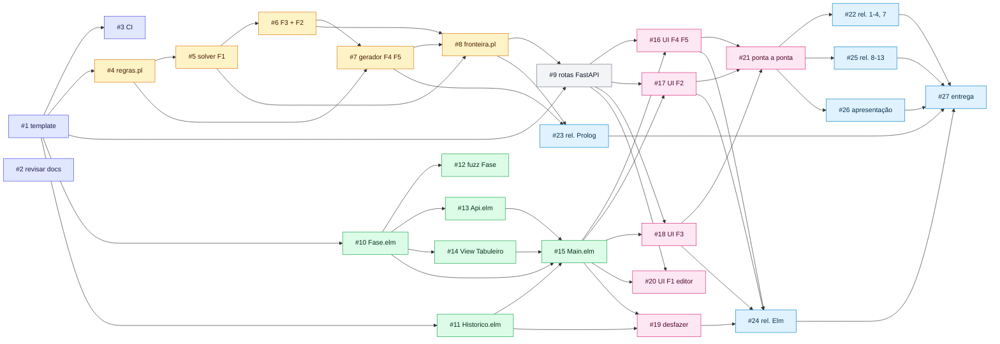
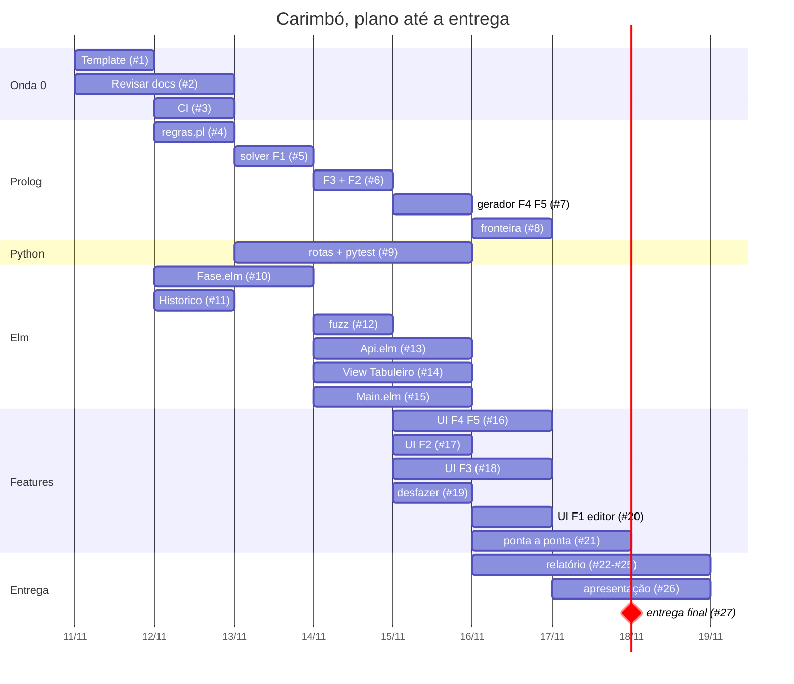

# Plano de issues

Prazo sem desconto: **18/11/2026, 23h59**. As issues estão no GitHub; este
documento mostra o panorama, as dependências e a ordem.

## Equipe e frentes

| Pessoa | GitHub | Frente principal |
|---|---|---|
| Arthur Alves Melo | @Arthrok | infra, Python, fronteira Prolog, integração, entrega |
| Caio Lucas Lelis Borges | @caio-lelis | Prolog: regras e gerador · editor de fases (Elm) |
| Isaque Santos | @IsaqueSH | Prolog: solver, dica, solução mínima · testes de borda |
| Maria Eduarda dos Santos Marques | @EduardaSMarques | Elm: domínio (`Fase`, `Historico`) e testes |
| João Pedro da Silva Rodrigues | @joaopedrodasilvarodrigues | Elm: `Api`, `Main`, tela de nova fase |
| Bruna de Lima Santos | @libruna | Elm: view do tabuleiro, visual, dica e solução na UI |

A divisão é uma sugestão: troquem à vontade, mas atualizem os responsáveis na
issue. **Todo mundo precisa conseguir explicar o código atribuído a si**
(seção 2.1 da avaliação), e todo mundo tem uma parte do relatório.

## As 5 features e onde cada uma aparece

| Feature | Prolog | UI |
|---|---|---|
| **F1** Verificar solução | #5 | #20 |
| **F2** Dica | #6 | #17 |
| **F3** Solução mínima | #6 | #18 |
| **F4** Gerador | #7 | #16 |
| **F5** Variantes | #7 | #16 |

## Lista de issues

### Onda 0: fundação (11–12/11)

| # | Issue | Responsável | Depende de |
|---|---|---|---|
| 1 | Trazer o template do professor e adaptar ao projeto | Arthur | — |
| 2 | Revisar e aprovar a documentação, os ADRs e o contrato da API | todos | — |
| 3 | CI no GitHub Actions (testes, elm-format, swipl sem avisos) | Arthur | 1 |

### Onda 1: núcleo em paralelo (13–15/11)

| # | Issue | Responsável | Depende de |
|---|---|---|---|
| 4 | `regras.pl`: carimbos, `afeta/4`, `apertar/3`, `resolvida/1` | Caio | 1 |
| 5 | `solver.pl`: modelo de restrições e **F1** verificar solução | Isaque | 1, 4* |
| 6 | `solver.pl`: **F3** solução mínima e **F2** dica | Isaque | 5 |
| 7 | `gerador.pl`: **F4** gerador e **F5** variantes | Caio | 4, 6 |
| 8 | `fronteira.pl`: API pública do Prolog para o Python | Arthur | 5, 6, 7 |
| 9 | Rotas FastAPI e testes pytest | Arthur | 1, 8* |
| 10 | `Fase.elm`: tipos do domínio, `apertar`, `resolvida`, `criar` | Maria Eduarda | 1 |
| 11 | `Historico.elm`: desfazer/refazer genérico + testes | Maria Eduarda | 1 |
| 12 | Testes fuzz de `Fase.elm` | Maria Eduarda | 10 |
| 13 | `Api.elm`: requisições, encoders, decoders, `Remoto` | João Pedro | 10 |
| 14 | `View/Tabuleiro.elm`: grid, ícones dos carimbos, visual | Bruna | 10 |
| 15 | `Main.elm`: Model, Msg, máquina de estados, clique local | João Pedro | 10, 11, 13, 14 |

\* Dá para começar antes usando o contrato ([`api.md`](api.md),
[`design-prolog.md`](design-prolog.md)) com stub ou mock, e integrar quando a
dependência fechar.

### Onda 2: features na UI (15–16/11)

| # | Issue | Responsável | Depende de |
|---|---|---|---|
| 16 | **F4 + F5** na UI: tela de nova fase (tamanho, nível, variante) | João Pedro | 9, 15 |
| 17 | **F2** na UI: pedir dica e destacar a célula | Bruna | 9, 15 |
| 18 | **F3** na UI: mínimo, animação da solução, tela de vitória | Bruna | 9, 15 |
| 19 | Desfazer, refazer e reiniciar na UI | Maria Eduarda | 11, 15 |
| 20 | **F1** na UI: editor de fases com verificação | Caio | 9, 15 |
| 21 | Integração ponta a ponta e casos de borda (seção 8 do relatório) | Arthur, Isaque | 16, 17, 18 |

### Onda 3: entrega (16–18/11)

| # | Issue | Responsável | Depende de |
|---|---|---|---|
| 22 | Relatório: seções 1–4 e 7 | Arthur | 21 |
| 23 | Relatório: seção 5 (Prolog) | Caio, Isaque | 7, 8 |
| 24 | Relatório: seção 6 (Elm) | Maria Eduarda, João Pedro, Bruna | 16–19 |
| 25 | Relatório: seções 8–13 (coletivas) | todos | 21 |
| 26 | Apresentação: roteiro de 15 min e ensaio | todos | 21 |
| 27 | Entrega: validador, repositório do Classroom, versão final | Arthur | 22–26 |

## Grafo de dependências

**Caminho crítico:** #1 → #4 → #5 → #6 → #7 → #8 → #9 → #16 → #21 → #27.
O Prolog é o gargalo, então ele começa primeiro e não pode atrasar.
Enquanto isso, o Elm avança com mock (#10–#15 não dependem do backend).

## Cronograma

## Etiquetas e marcos no GitHub

- **Marcos:** `Onda 0: fundação` (12/11), `Onda 1: núcleo` (15/11),
  `Onda 2: features` (16/11), `Onda 3: entrega` (18/11).
- **Etiquetas de área:** `prolog`, `elm`, `backend`, `infra`, `docs`,
  `relatório`, `entrega`.
- **Etiquetas de feature:** `F1-verificar`, `F2-dica`, `F3-minima`,
  `F4-gerador`, `F5-variantes`.
- **Outras:** `extra` (dá para cortar se o prazo apertar: #20, a animação
  de #18).
